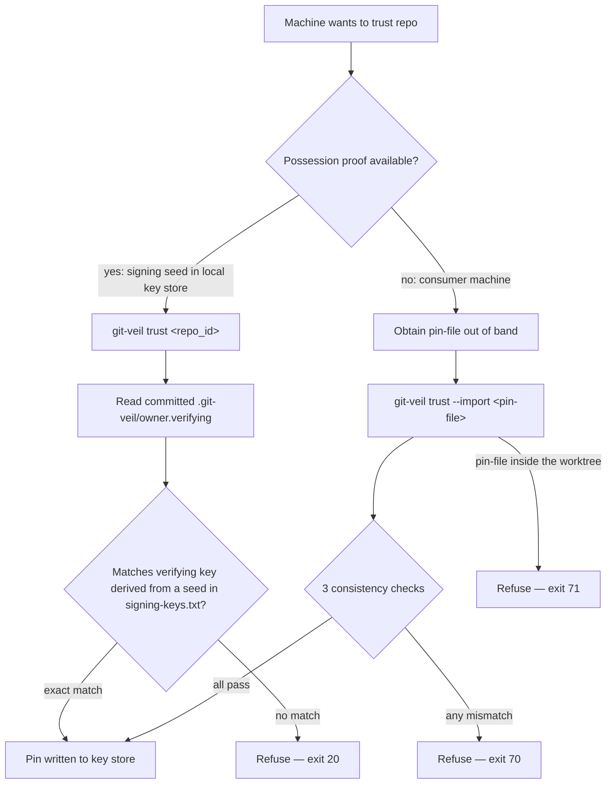
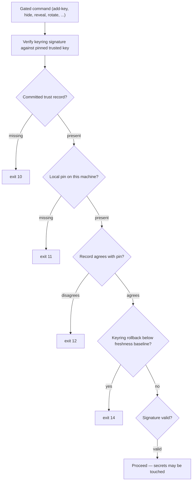

# Trust And Pinning Model

This section has diagrams that explain the **trust** section of the `git-veil` command reference. 

The repo owner commits the public part of their signing key into the repo. An attacker could replace the real public key with their own. We require the user to assert trust in the owner's signing-key fingerprint only once. 

## Trust Anchors And PINs 

We pin the fingerprint to the git service, organisation, and repo, which we call the `repo-id`:

## How the pinned trust anchor is used

Every command that touches secrets runs this check first. No pin, or a bad signature, means nothing is touched.

## The export-pin → import ceremony

The pin-file always travels out of band (scp, USB, read aloud), never through the repository - the `known_hosts` provisioning model.

## Trust commands and exit codes

| Command | Purpose | Notable exit codes |
| --- | --- | --- |
| `trust <repo_id>` | Possession proof; pin from committed `.git-veil/owner.verifying` | 13, 20, 70, 71, 30 |
| `trust --import <pin-file>` | Pin from an exported pin-file, out of band | 13, 20, 70, 71, 30 |
| `export-pin` | Write pin-file for machines without the signing key | 20, 71, 30 |
| `fingerprint <label> <public_key>` | Pure `SHA-256(label:encoding)` derivation, no state | usage errors (2) |
| `verify-keys` | Cheap health check of the gate above | 10, 11, 12, 14, 63, 70, 30 |
| `trust-permissions` | Acknowledge key-store permission state (exit 30) | 30 |

**Refused as hostile:** a pin or trust record in the old 16-hex-character fingerprint format is refused until trust is re-established (exit 70).

**Typical order:** `init` → `trust` → `add-key` → `rotate`. 
